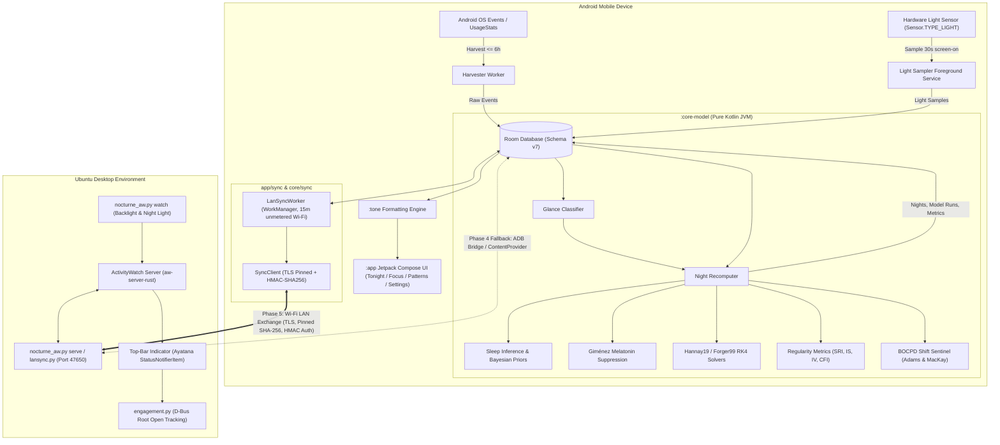
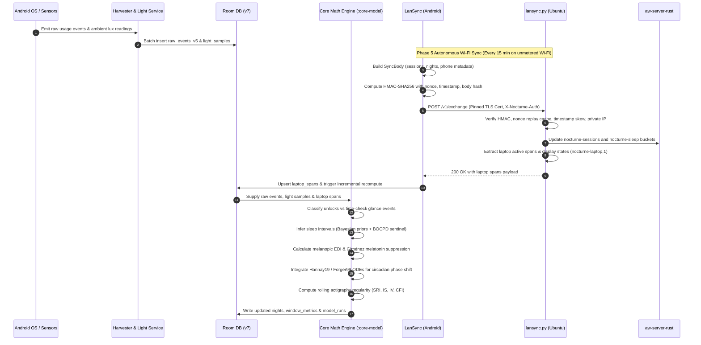
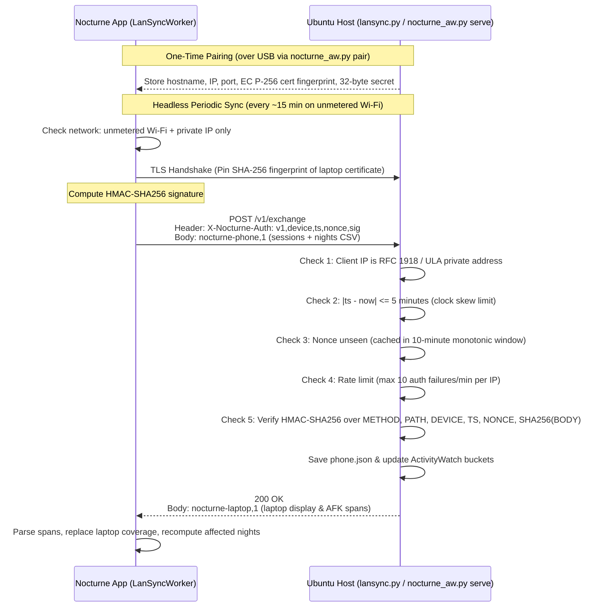
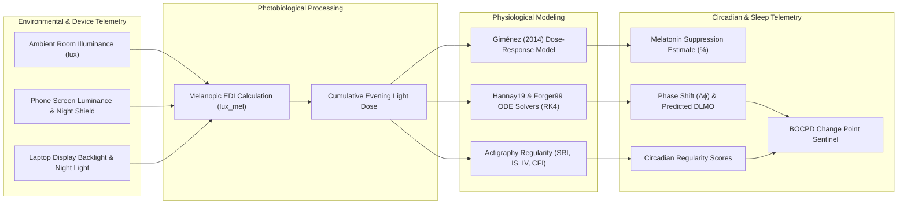
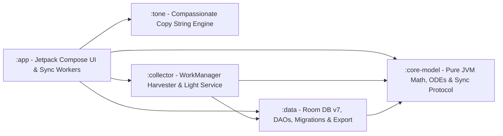

# Nocturne

[](https://kotlinlang.org/)
[](https://developer.android.com/)
[](https://developer.android.com/jetpack/compose)
[-F9AB00?logo=sqlite&logoColor=white)](https://developer.android.com/training/data-storage/room)
[-3776AB?logo=python&logoColor=white)](https://www.python.org/)
[](#key-pillars)
[](#license)

**Nocturne** is a personal Android and Linux scientific instrument for perpetual, high-resolution telemetry of night-time device usage, non-wearable sleep inference, and biophysical modeling of circadian light exposure.

Unlike commercial screen-time trackers or Digital Wellbeing—which purge raw event logs after ~7 days and treat all screen interactions identically—Nocturne operates on a strict **local-first, zero-cloud architecture**. It captures millisecond-accurate raw Android events indefinitely, distinguishes brief time-check glance wakes from deep interactive sessions, solves published physiological differential equations (Giménez melatonin suppression, Hannay 2019 and Forger 1999 ODE circadian phase estimators), monitors behavioral change points via Bayesian Online Change Point Detection (BOCPD), and unifies mobile telemetry with Linux desktop activity via ActivityWatch over autonomous, pinned-TLS Wi-Fi LAN sync.

---

## Key Pillars

1. **Indefinite Local Retention**:
   - Android OS `UsageStatsManager` discards granular event streams after approximately 7 days.
   - Nocturne harvests raw Android events into an append-only Room SQLite database stored on-device forever.
   - Event package and class names are interned into normalized component tables (`event_components`), shrinking the storage footprint by ~67% (~28 MB/year across ~66,000+ raw events).
2. **Glance-Level Resolution**:
   - Differentiates between interactive app sessions, keyguard dismissals, and momentary screen wakes (e.g., checking the lock screen for 4 seconds).
   - Prevents momentary checks from artificially resetting sleep latency or distorting wake onset boundaries.
3. **Physiological Circadian & Sleep Modeling**:
   - **Light & Melatonin**: Combines ambient room lux from `Sensor.TYPE_LIGHT` with screen luminance and laptop display state into melanopic Equivalent Daylight Illuminance (EDI). Models melatonin suppression via the Giménez (2014) non-linear dose-response curve.
   - **Passive Sleep Inference**: Detects sleep onset and wake without wearables by evaluating multi-device state transitions, alarm interactions, and Bayesian priors (Student-t distributions over habitual onsets).
   - **Circadian Dynamics (ODE Solvers)**: Integrates 4th-order Runge-Kutta (RK4) solvers of published 3-state ODE models (Hannay 2019, Forger 1999) to predict individual Dim Light Melatonin Onset (DLMO) and phase shift ($\Delta \phi$).
   - **Actigraphy Regularity Metrics**: Calculates Sleep Regularity Index (SRI), Interdaily Stability (IS), Intradaily Variability (IV), Relative Amplitude (RA), and Circadian Function Index (CFI) across rolling 7/14/28-night windows.
   - **Bayesian Online Change Point Detection (BOCPD)**: Adams & MacKay (2007) changepoint recursion implemented in pure JVM Kotlin to detect systemic shifts in sleep onset and weekly regularity without human labeling.
4. **Autonomous Cross-Platform Integration (Phase 5 Wi-Fi LAN Sync)**:
   - Synchronizes bi-directionally with `aw-server-rust` (ActivityWatch) on Ubuntu Linux.
   - Phone initiates periodic sync exchanges every 15 minutes over unmetered home Wi-Fi—no open listening ports on Android, no cloud relay, and no daily USB cable requirements.
   - Protected by pinned self-signed EC P-256 TLS certificates, HMAC-SHA256 signed requests (`X-Nocturne-Auth`), anti-replay nonces, and private-network IP restrictions.
5. **Desktop Telemetry & Ambient Awareness**:
   - Linux systemd daemon tracks laptop display brightness and GNOME Night Light status.
   - Top-bar desktop indicator (`nocturne_indicator.py`) displays dynamic circadian states, countdowns, staleness alerts, and tracks engagement metrics via D-Bus root events.
6. **Compassionate Copy & Objective Data Manifesto**:
   - Strictly enforced by the `:tone` module: merciless, high-precision telemetry paired with neutral, non-judgmental language.
   - Zero guilt copy, zero blaming adjectives, zero exclamation marks, and zero emojis in insight strings.

---

## System Architecture



---

## End-to-End Processing Pipeline



---

## Phase 5: Autonomous Wi-Fi LAN Sync

### 1. Architectural Motivation
Prior to Phase 5, cross-device sync relied on ADB over USB or TCP. However:
- **ADB Authorization Expiry**: Android automatically revokes ADB authorizations after 7 days of inactivity (`adb_allowed_connection_time = 604,800,000 ms`), breaking automated headless synchronization.
- **Doze & Android Listeners**: Android apps cannot reliably run TCP listening sockets while idle; Android Doze suspends network access for inactive apps, and open listening ports introduce unnecessary attack surface.
- **Laptop Power Cycles**: Laptops power on and off multiple times daily (e.g., 4–5 short sessions, off overnight). A daily scheduled batch sync routinely misses laptop availability.

### 2. The Protocol & Security Model
Phase 5 introduces an **autonomous, phone-initiated, bi-directional LAN exchange**:



- **Zero Phone Ports**: The phone acts exclusively as a TLS client. The laptop listens on port `47650` only while booted.
- **Certificate Pinning**: The laptop generates an EC P-256 self-signed certificate. During the initial USB pairing, the phone securely stores the SHA-256 fingerprint of the certificate DER bytes. Any DNS poisoning or Wi-Fi spoofing results in immediate TLS termination.
- **HMAC Request Authentication**: Every request carries an `X-Nocturne-Auth` header signing the HTTP method, path, device identifier, timestamp, unique 128-bit hex nonce, and the SHA-256 hash of the payload.
- **Anti-Replay & Flood Protection**: Nonces are remembered in a 10-minute sliding window; requests with clock skew > 5 minutes are rejected (403); and repeated failures from any address are rate-limited (429).
- **Concurrency & Handshake Timeouts**: The server enforces a multi-threaded handshake pool (max 16 concurrent connections) with 10s handshake and 30s request timeouts to prevent slowloris starvation.
- **Strict Network Boundary**: Nocturne declares `android.permission.INTERNET` exclusively for `core-model/sync`. The test suite runs `NetworkSurfaceTest`, which statically scans the codebase and fails the build if any other file opens a socket or introduces network dependencies.


### 3. Starting it, and what the phone is told when nothing was recording
- **One command on the laptop**: `tools/activitywatch/install-services.sh` enables ActivityWatch, the watcher, the sync server and the top-bar moon as systemd user units, so they start at every login. Without them nothing records laptop use and the phone reports "did not answer".
- **Recording gaps (Phase 6a, schema 8)**: ActivityWatch cannot tell a laptop that was off from one that was on with the watcher not running. `power_log.py` reads boot and suspend times from the journal, and the laptop file carries `gap` rows for awake time nothing recorded. A modelled evening that overlaps one says so ("The laptop was on for N minutes of this evening with nothing recording it, so this figure may be low"), and the personal sensitivity fit will skip it.

---

## Desktop ActivityWatch Integration & Top-Bar Indicator

### 1. Laptop Presence & Display Watchers
The laptop integration (`tools/activitywatch/nocturne_aw.py`) connects to `aw-server-rust`:
- **`nocturne-display_<host>`**: Samples display backlight percentage and GNOME Night Light state every 60 seconds.
- **`aw-watcher-afk_<host>`**: Standard ActivityWatch user presence monitoring.
- **`nocturne-laptop,1`**: Generates spans combining user presence with display luminance to calculate laptop light exposure and integrate laptop shutdowns/boots into sleep boundary inference.

### 2. Ubuntu Ayatana Top-Bar Indicator
The desktop indicator (`tools/activitywatch/nocturne_indicator.py`) sits in Ubuntu's top panel using `libayatana-appindicator3`:

| State | Visual Icon | Top-Bar Label | Meaning |
|---|---|---|---|
| **Day** | Dim Moon | None (or countdown in last 3h) | Normal daytime operation; display and presence active. |
| **Evening Window** | Bright Moon + Star | None | Current time falls within personal evening light window. |
| **Stopped / Warning** | Faded Moon + Amber Dot | `"not recording"` | ActivityWatch server down or presence watcher stopped (> 5 min). |

- **3-Hour Lead-Up Logic**: The countdown label (e.g., `"evening at 21:30"`) appears **only** in the 3 hours immediately preceding the evening window. Outside this window, static times are hidden to prevent confusing duplicate clock indicators.
- **Staleness Indicators**: Explicitly identifies whether data is fresh, if presence tracking stalled, or if evening window boundaries reflect last week's sync.
- **Engagement Monitoring (`engagement.py`)**: Intercepts D-Bus `opened` events on the indicator menu root to log how often the indicator menu is actively opened and how many days it runs. Summarized in `nocturne_aw.py status` to measure whether the ambient display is read or ignored.

---

## Circadian & Physiological Models



### 1. Melanopic Light Dose & Melatonin Suppression
- **Corneal Illuminance Model**: Merges room lux from `Sensor.TYPE_LIGHT` with estimated screen emission derived from display brightness levels and dark mode/warm filter states.
- **Giménez Dose-Response Model**: Evaluates the non-linear saturation curve:
  $$\text{Suppression} = \frac{I_{\text{mel}}^p}{I_{\text{mel}}^p + \text{EC}_{50}^p}$$
  quantifying light-induced melatonin suppression during the evening window ($t = \text{Sleep Onset} - 3\text{h}$).

### 2. Sleep Inference Engine & Bayesian Priors
- Aggregates multi-device interaction boundaries: last phone screen-off, alarm dismissions, keyguard events, and laptop AFK/shutdown timestamps.
- Evaluates Student-t conjugate priors over habitual onset and wake times, with an explicit prior for sleepless nights.

### 3. Circadian Phase Dynamics (Hannay19 & Forger99)
- Implements 4th-order Runge-Kutta (RK4) numerical integration of the 3-state **Hannay 2019** limit-cycle oscillator and **Forger 1999** circadian pacemakers.
- Accurately tracks individual circadian phase shifts ($\Delta \phi$) and predicts Dim Light Melatonin Onset (DLMO) under complex real-world light profiles.
- Cross-validated against gold-standard Python references (`Arcascope/circadian` 1.0.3).

### 4. Bayesian Online Change Point Detection (BOCPD)
- Pure Kotlin implementation of **Adams & MacKay (2007)** online changepoint recursion (`detect/Bocpd.kt`).
- Utilizes Normal-Inverse-Gamma priors and Student-t predictive distributions with constant hazard rate.
- Computed in exact log-space without pruning:
  - Tracks nightly sleep onset shifts and weekly Sleep Regularity Index (SRI).
  - Enforces a 60-night baseline requirement before surfacing changepoints.
  - Alert threshold set at $P(\text{change}) \ge 0.8$; triggers early Tier 3 model refitting at $P \ge 0.9$.
  - Exact golden file verification matching PyPI reference posteriors within $10^{-9}$.

---

## Database Schema Progression

Nocturne uses Android Room with zero-data-loss automated and hand-written migrations:

| Version | Tables Added / Changed | Architectural Milestone |
|:---:|---|---|
| **v1** | `raw_events_v4`, `sessions`, `session_apps` | Baseline event harvesting and interactive session reconstruction. |
| **v2** | `nights`, `sleep_reports` | Sleep onset/wake inference, user time labels, confidence scores. |
| **v3** | `light_samples`, `power_samples` | Ambient sensor telemetry and charging state records. |
| **v4** | `window_metrics`, `model_runs` | Rolling 7/14/28-night actigraphy regularity metrics (SRI, IS, IV, CFI). |
| **v5** | `event_components`, `raw_events_v5` | Interned package/class strings; reduced event storage by 67%. |
| **v6** | `reflections`, `focus_blocks`, `zone_changes` | Micro-EMA gap cards, exact-alarm focus timers, dropped obsolete `raw_events_v4`. |
| **v7** | `laptop_spans`, `laptop_hosts`, `nights.lightLaptopMinutes` | Phase 4/5 cross-device ActivityWatch sync and laptop light modeling. |

---

## Data Export & Empirical Soak Validation

### 1. Comprehensive Full Export
Users can extract the entire database as a portable `.zip` of CSVs without requiring ADB:
- **In-App**: Settings $\rightarrow$ **Export all data**
- **ADB Command**:
  ```bash
  adb shell am broadcast -n io.github.anbu00001.nocturne/.debug.DebugReportReceiver --es export all
  ```
  Exports `raw_events.csv` (with interned strings resolved), `sessions.csv`, `nights.csv`, `light_samples.csv`, `reflections.csv` (gap ratings; note text omitted for privacy), `window_metrics.csv`, `laptop_spans.csv`, and an `about.csv` system manifest.

### 2. Empirical 12-Day Soak Findings
- **Harvest Reliability**: 312 out of 312 scheduled harvests succeeded across a 7-day soak window; 859 of 860 completed since initial install (longest gap 5.9 h, comfortably within the 6 h OS buffer limit).
- **Storage Efficiency**: 65,863 raw events, 3,308 sessions, 9,989 light samples, and 30 nights occupied only **2.9 MB** of SQLite storage after string interning.
- **Cross-Device Correlation**: Laptop shutdown timestamps aligned with inferred sleep onset within 30 minutes on 14 of 23 nights (median 19 min; seven within 3 min), and next morning boots followed wake by a median of 80 min.
- **Phase 5 Verification**: Validated autonomous reconnection following laptop reboot without ADB running; transferred 3,319 sessions and 30 nights in under 2 seconds.

---

## Multi-Module Codebase Structure



- **`:core-model`**: Pure Kotlin JVM module with **zero Android dependencies**. Contains ODE solvers (Hannay19, Forger99), Giménez suppression math, sleep inference, Bayesian priors, BOCPD changepoint detection, actigraphy metrics, and `core.sync` protocol cryptographic primitives (`SyncAuth`, `SyncClient`, `PrivateAddress`).
- **`:tone`**: Pure string formatting module. Centralizes all UI and indicator copy, enforcing non-judgmental, neutral language with zero emojis and zero exclamation marks.
- **`:data`**: Room Database v7 implementation, DAOs, automated and manual migrations (v1 through v7), CSV/Zip data export engine (`DataExport`), and `LaptopBridgeProvider`.
- **`:collector`**: Android background harvesting (`HarvesterWorker`), foreground ambient light sensor service (`LightSamplerService`), boot and timezone receivers.
- **`:app`**: Jetpack Compose UI with four tabs:
  - **Tonight**: Real-time evening light dose, eye lux, glance counter, modelled melatonin suppression, and countdown to evening window.
  - **Focus**: Exact-alarm timer, phone-down gap cards, unlock counters, and reflection prompts.
  - **Regularity (Patterns)**: SRI scores, onset/wake distributions, IS/IV actigraphy charts, and weekly history.
  - **Settings**: Wi-Fi sync controls (paired laptop, sync now, forget), sensor diagnostics, export triggers, and display profiles.
- **`tools/activitywatch`**: Python daemons (`lansync.py`, `nocturne_aw.py`, `nocturne_indicator.py`, `engagement.py`) and systemd user services for Ubuntu.
- **`tools/circadian` & `tools/bocpd`**: Python oracle verification suites used as test goldens.

---

## Development & Operational Setup

### Prerequisites
- **JDK**: Version 17
- **Android SDK**: Platform 37.2 (Build Tools 36+, `targetSdk` 36, Compose BOM 2026.09)
- **Gradle**: 9.6.0 (via wrapper)
- **Python**: 3.10+ (Standard library only; OpenSSL for initial certificate generation)
- **Linux Desktop**: Ubuntu 24.04 LTS (with `libayatana-appindicator3` for top-bar indicator)

### 1. Build and Run Tests
Execute the JVM test suite across all modules:
```bash
./gradlew :core-model:test :tone:test :data:testDebugUnitTest :collector:testDebugUnitTest
```

Run Python ActivityWatch and sync unit tests:
```bash
python3 -m unittest discover -s tools/activitywatch
```

### 2. Install on Android Device
Connect your Android device via USB with ADB debugging enabled:
```bash
./gradlew :app:installDebug
```

### 3. Setup ActivityWatch & Wi-Fi LAN Sync on Linux
Install systemd user services:
```bash
mkdir -p ~/.config/systemd/user && cp tools/activitywatch/systemd/* ~/.config/systemd/user/
systemctl --user daemon-reload
systemctl --user enable --now aw-server.service nocturne-watch.service nocturne-serve.service nocturne-indicator.service
```

Perform one-time pairing over USB:
```bash
# Connect phone via USB once to pair TLS certificate and cryptographic secret:
python3 tools/activitywatch/nocturne_aw.py pair
```

Verify service and sync status:
```bash
python3 tools/activitywatch/nocturne_aw.py status
```

*(Once paired, disconnect USB. The phone will autonomously sync over home Wi-Fi every 15 minutes whenever the laptop is on.)*

---

## Tone Policy & Ethical Philosophy

Nocturne adheres to a strict design and copy manifesto:
- **Merciless Numbers**: Report raw, precise measurements (e.g., `"72 minutes at screen"`, `"Melatonin suppression: 34%"`).
- **Zero Moralizing**: Never use adjectives like `"excessive"`, `"good"`, `"bad"`, or `"unhealthy"`.
- **No Guilt Induction**: Never prompt users to feel shame regarding their technology habits.
- **Zero Gimmicks**: Strictly no emojis, no exclamation points, and no congratulatory streaks in insight copy.

---

## License

Personal scientific instrument. All rights reserved.
